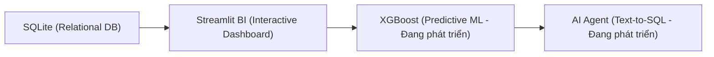

# 🛍️ AI-Powered E-Commerce Analytics & Conversational Agent

> Nền tảng phân tích dữ liệu thương mại điện tử: Kết hợp trực quan hóa số liệu trực quan (Interactive BI Dashboard), tối ưu hóa hiệu năng tính toán trong bộ nhớ, mô hình học máy dự báo rủi ro vận hành và tác tử thông minh (AI Agent / Text-to-SQL).

[](https://github.com/pttlinh32/ecommerce-ai-analytics)
[](https://www.python.org/)
[](https://streamlit.io/)
[](https://opensource.org/licenses/MIT)

🌐 **Trải nghiệm ứng dụng trực tiếp tại:** [https://ecommerce-ai-analytics.streamlit.app/](https://ecommerce-ai-analytics.streamlit.app/)

---

## 📌 1. Bài toán & Mục tiêu dự án (Problem Statement)

Trong các doanh nghiệp bán lẻ và thương mại điện tử, các báo cáo quản trị truyền thống (Excel / BI tĩnh) thường gặp các điểm nghẽn:
1. **Báo cáo nhìn về quá khứ:** Chỉ phản ánh số liệu đã phát sinh, thiếu khả năng cảnh báo sớm các rủi ro vận hành (đơn hàng giao trễ, đánh giá tiêu cực).
2. **Quy trình truy xuất dữ liệu thủ công:** Phụ thuộc vào kỹ sư dữ liệu viết SQL mỗi khi cần đào sâu chỉ số chuyên biệt.
3. **Thiếu tính liền mạch:** Công cụ phân tích tĩnh, mô hình dự đoán và giao diện tương tác bị phân mảnh thành nhiều hệ thống riêng biệt.

**Mục tiêu của dự án:** Xây dựng một **Web Data Application** toàn diện theo kiến trúc module hóa:



Hệ thống được kiểm thử tự động và vận hành liên tục thông qua quy trình **CI/CD** với GitHub Actions.

<!-- TODO: thêm ảnh dashboard -->

---

## 📅 2. Tiến độ dự án (Project Roadmap)

- [x] **Giai đoạn 1: Chuẩn bị CSDL & Data Pipeline** (Làm sạch dữ liệu Olist Brazil, chuẩn hóa schema SQLite, thiết lập CI/CD và bộ kiểm thử tự động).
- [x] **Giai đoạn 2: Dashboard BI Executive** (Bộ lọc đa chiều, 4 tab phân tích chuyên sâu, xuất báo cáo UC04 Excel/CSV, Việt hóa 138/138 danh mục & 27 bang, tối ưu hóa tốc độ in-memory pandas).
- [ ] **Giai đoạn 3: Machine Learning (Đang phát triển)** (Mô hình XGBoost dự báo rủi ro giao hàng trễ và phân cụm khách hàng RFM).
- [ ] **Giai đoạn 4: AI Analytics Agent (Đang phát triển)** (Tác tử chuyển đổi ngôn ngữ tự nhiên Text-to-SQL & sinh biểu đồ trực quan).
- [ ] **Giai đoạn 5: Triển khai & Đóng gói sản phẩm (Đang phát triển)** (Tối ưu production bundle, container hóa Docker và hoàn thiện tài liệu).

---

## ⚡ 3. Kết quả nổi bật (Key Milestones)

Dự án đã giải quyết bài toán hiệu năng của SQLite khi thực thi đồng thời nhiều truy vấn JOIN phức tạp trên tập dữ liệu ~100.000 đơn hàng thông qua kiến trúc nạp bảng phẳng và lọc trong bộ nhớ (in-memory pandas):

| Chỉ số / Tình huống | Trước tối ưu | Sau tối ưu | Ghi chú |
| :--- | :---: | :---: | :--- |
| **Nạp dữ liệu lần đầu (1 lần)** | *Chưa có* | **~14,76 s** (~15s) | Nạp 2 bảng phẳng (`orders_fact`, `items_fact`) vào cache Streamlit |
| **Mỗi lần đổi bộ lọc (lọc + 10 hàm tính)** | **40,77 s** | **0,586 s** | Tăng tốc **69,5 lần**, phản hồi dưới 1 giây |
| **Kiểm thử tự động (pytest)** | 2 tests | **83 / 83 tests PASSED** | 49 unit tests + 34 integration tests đối chiếu logic vs SQL |
| **Bản địa hóa tiếng Việt** | 0% | **138 / 138 danh mục (100%)** | 138 mã danh mục DB & 27 bang Brazil theo ISO 3166-2:BR |

---

## ✨ 4. Các tính năng cốt lõi (Core Features)

### 📊 Phân hệ 1: Descriptive Analytics (Dashboard BI Executive - Đã hoàn thành)
* **Trang chủ (`app/main.py`):** Tổng quan số liệu toàn sàn (99.441 đơn hàng, 96.096 khách hàng, R$ 16,0 triệu doanh thu), giới thiệu các phân hệ và nút điều hướng.
* **Bộ lọc đa chiều tương tác:** Khoảng thời gian (mặc định 2017-01-01 đến 2018-08-31), Bang khách hàng (sắp theo lượng đơn giảm dần), Danh mục sản phẩm (sắp theo doanh thu giảm dần), Trạng thái đơn hàng.
* **4 Tab phân tích chuyên sâu:**
  1. *Executive Summary:* 6 thẻ KPI (Doanh thu, Đơn hàng, Khách hàng, AOV, Điểm đánh giá, Giao đúng hạn) kèm delta so sánh kỳ trước; Biểu đồ doanh thu kết hợp tăng trưởng MoM đối xứng trục 0.
  2. *Vận hành & Giao nhận:* Mối tương quan độ trễ vs điểm đánh giá; Tỷ lệ trễ theo bang (đường tham chiếu trung bình toàn sàn có trọng số 6,6%); Khung nhận định vận hành thông minh.
  3. *Danh mục sản phẩm:* Doanh số & sản lượng theo top N danh mục; Tỷ trọng doanh thu nhóm dẫn đầu.
  4. *Khách hàng & Địa lý:* Doanh thu theo bang, cơ cấu thanh toán, heatmap đơn hàng theo giờ & thứ trong tuần, tỷ lệ mua lại (Repeat Rate).
* **Xuất báo cáo (UC04):** Tải dữ liệu đơn hàng và KPI đã lọc sang định dạng Excel (`.xlsx` 2 sheets) hoặc CSV (`utf-8-sig`), tự động giới hạn an toàn 50.000 dòng.

### 🔮 Phân hệ 2: Predictive Analytics (AI Dự báo rủi ro vận hành - Đang phát triển)
* Huấn luyện mô hình học máy (`Scikit-learn` / `XGBoost`) trên dữ liệu vận chuyển và hành vi khách hàng.
* Dự báo rủi ro giao hàng trễ (Delivery Delay Risk) và cảnh báo nguy cơ đánh giá thấp (1-2 sao) cho từng đơn hàng mới.

### 🤖 Phân hệ 3: AI Agent & Conversational Analytics (Tác tử dữ liệu - Đang phát triển)
* Ứng dụng mô hình AI Agent (Tool Calling / Text-to-SQL):
  * Chuyển đổi câu hỏi tự nhiên tiếng Việt thành truy vấn SQL trực tiếp trên SQLite.
  * Tự động sinh biểu đồ Plotly và phân tích giải thích kết quả cho người dùng.

---

## 🛠️ 5. Công nghệ sử dụng (Tech Stack)

| Lĩnh vực | Công nghệ | Mục đích sử dụng |
| :--- | :--- | :--- |
| **Ngôn ngữ** | `Python 3.10+`, `SQL` | Xử lý dữ liệu và xây dựng logic ứng dụng |
| **Lưu trữ dữ liệu** | `SQLite` | Cơ sở dữ liệu quan hệ lưu trữ dữ liệu sàn Olist (`data/ecommerce.db`) |
| **Xử lý số liệu** | `Pandas`, `NumPy` | Xử lý dữ liệu in-memory, biến đổi bảng phẳng và tính toán KPI |
| **Trực quan hóa (BI)** | `Plotly Express` | Thiết kế các biểu đồ tương tác động (Doanh thu, MoM, Bar, Pie, Heatmap) |
| **Giao diện Web App** | `Streamlit` | Xây dựng giao diện Web phân tích nhiều trang (`app/main.py`, `app/pages/`) |
| **Kiểm thử & CI/CD** | `Pytest`, `GitHub Actions` | 83 bài kiểm thử tự động (unit test & integration test) chạy trên CI |
| **Machine Learning** | `Scikit-learn`, `XGBoost` | *(Đang phát triển)* Huấn luyện mô hình dự báo rủi ro vận hành |
| **Tác tử AI** | `LangChain`, LLM API | *(Đang phát triển)* Chuyển đổi câu hỏi tự nhiên Text-to-SQL |

---

## 📐 6. Cấu trúc thư mục (Project Structure)

```text
ecommerce-ai-analytics/
├── .github/workflows/        # Pipeline CI/CD tự động kiểm thử (ci.yml)
├── app/                      # Mã nguồn ứng dụng Streamlit
│   ├── main.py               # Trang chủ giới thiệu & tổng quan sàn
│   └── pages/
│       └── 01_dashboard.py   # Dashboard BI Executive (4 tabs & xuất báo cáo)
├── data/
│   └── ecommerce.db          # Cơ sở dữ liệu SQLite chuẩn hóa
├── docs/                     # Tài liệu kỹ thuật, kiến trúc & nhật ký
│   ├── database_erd.md       # Thiết kế CSDL & sơ đồ ERD
│   ├── use_case.md           # Đặc tả nghiệp vụ & yêu cầu Use Cases
│   └── dev_log.md            # Nhật ký thử nghiệm & tối ưu hóa hiệu năng
├── src/                      # Source code logic nghiệp vụ
│   ├── db.py                 # Hàm kết nối CSDL và truy vấn SQL chuẩn
│   ├── analytics.py          # Module tính toán in-memory pandas tối ưu
│   └── ui/                   # Giao diện & bản địa hóa (labels, filters, theme)
├── tests/                    # Bộ kiểm thử tự động (83 bài test)
│   ├── test_db*.py           # Unit tests kiểm thử CSDL & bộ lọc
│   ├── test_labels.py        # Unit & Integration tests bản địa hóa tiếng Việt
│   └── test_analytics_vs_sql.py # Integration tests đối chiếu pandas vs SQL
├── requirements.txt          # Danh sách thư viện phụ thuộc
└── README.md                 # Tài liệu hướng dẫn dự án
```

---

## 🚀 7. Hướng dẫn cài đặt & Cách chạy (Getting Started)

### Yêu cầu hệ thống
* Đã cài đặt **Python 3.10+** và **Git**.

### Các bước thực hiện:

1. **Clone repository về máy:**
   ```bash
   git clone https://github.com/pttlinh32/ecommerce-ai-analytics.git
   cd ecommerce-ai-analytics
   ```

2. **Khởi tạo và kích hoạt môi trường ảo (venv):**
   * *Trên Windows (PowerShell):*
     ```powershell
     python -m venv .venv
     .\.venv\Scripts\activate
     ```
   * *Trên macOS/Linux:*
     ```bash
     python3 -m venv .venv
     source .venv/bin/activate
     ```

3. **Cài đặt các thư viện cần thiết:**
   ```bash
   pip install -r requirements.txt
   ```

4. **Khởi chạy ứng dụng Web (Streamlit):**
   ```bash
   streamlit run app/main.py
   ```
   Trình duyệt sẽ tự động mở ứng dụng tại địa chỉ: `http://localhost:8501`.

5. **Chạy kiểm thử tự động (Pytest):**
   * *Chạy bộ unit test nhanh (49 bài test, ~1.5 giây):*
     ```bash
     python -m pytest -v -m "not integration"
     ```
   * *Chạy riêng bộ integration test đối chiếu DB (34 bài test, ~2.5 phút):*
     ```bash
     python -m pytest -v -m "integration"
     ```
   * *Hoặc chạy toàn bộ kiểm thử (83 bài test):*
     ```bash
     python -m pytest -v
     ```

---

## 📚 8. Tài liệu tham khảo (Documentation)

- [Kiến trúc CSDL & Sơ đồ ERD](docs/database_erd.md): Thiết kế thực thể dữ liệu Olist và các mối quan hệ quan hệ.
- [Đặc tả nghiệp vụ & Use Cases](docs/use_case.md): Đặc tả 4 Use Cases cốt lõi (UC01-UC04), yêu cầu chức năng (F) và phi chức năng (NF).
- [Nhật ký phát triển (Dev Log)](docs/dev_log.md): Toàn bộ ghi chép kỹ thuật, quá trình tối ưu hiệu năng (tăng tốc 69,5x) và các bài học kiến trúc.

---

## ⚠️ 9. Lưu ý quan trọng (Important Notes)

> [!WARNING]
> - **Không commit lại file `data/ecommerce.db`:** File CSDL SQLite hiện tại đã được cấu hình tối ưu để phục vụ CI/CD tự động kiểm thử. Vui lòng không commit đè hoặc sửa đổi file database trực tiếp trừ khi có yêu cầu thay đổi schema.
> - **Phạm vi dữ liệu Olist:** Tập dữ liệu thương mại điện tử Olist Brazil được thu thập trong giai đoạn **2016 – 2018**. Khoảng thời gian có dữ liệu hoàn chỉnh và ổn định nhất để phân tích là từ **01/01/2017 đến 31/08/2018** (đã được cấu hình làm mốc lọc mặc định trên Dashboard).
