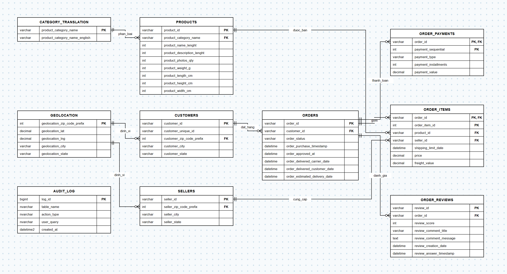

# 🗄️ Database Schema & Entity Relationship Diagram (ERD)

Tài liệu thiết kế cơ sở dữ liệu quan hệ (Relational Database Schema) cho dự án **E-Commerce Smart Analytics & Conversational AI Platform**.

---

## 📌 1. Sơ đồ thực thể liên kết (ERD)

> 💡 **File thiết kế gốc:** Bạn có thể mở trực tiếp file [`ecommerce_erd.drawio`](ecommerce_erd.drawio) bằng công cụ [Draw.io (app.diagrams.net)](https://app.diagrams.net) hoặc Extension Draw.io trong VS Code để tùy chỉnh và kéo thả trực quan.

---

## 📊 2. Danh mục các thực thể & Bảng dữ liệu (Data Entities)

| TT | Tên Bảng (Table) | Mô tả nghiệp vụ | Khóa chính (PK) | Khóa ngoại (FK) |
| :---: | :--- | :--- | :--- | :--- |
| **1** | `CUSTOMERS` | Thông tin khách hàng và mã định danh duy nhất | `customer_id` | `customer_zip_code_prefix` $\rightarrow$ `GEOLOCATION` |
| **2** | `ORDERS` | Quản lý vòng đời trạng thái và mốc thời gian của đơn hàng | `order_id` | `customer_id` $\rightarrow$ `CUSTOMERS` |
| **3** | `ORDER_ITEMS` | Chi tiết từng sản phẩm, giá bán, phí ship và người bán trong đơn | `(order_id, order_item_id)` | `order_id` $\rightarrow$ `ORDERS` `product_id` $\rightarrow$ `PRODUCTS` `seller_id` $\rightarrow$ `SELLERS` |
| **4** | `ORDER_PAYMENTS` | Hình thức thanh toán, số đợt trả góp và giá trị giao dịch | `(order_id, payment_sequential)` | `order_id` $\rightarrow$ `ORDERS` |
| **5** | `ORDER_REVIEWS` | Điểm đánh giá (1-5 sao) và nội dung phản hồi của khách hàng | `review_id` | `order_id` $\rightarrow$ `ORDERS` |
| **6** | `PRODUCTS` | Thông tin quy cách, kích thước, trọng lượng và danh mục | `product_id` | `product_category_name` $\rightarrow$ `CATEGORY_TRANSLATION` |
| **7** | `SELLERS` | Danh sách đối tác người bán và vị trí hoạt động | `seller_id` | `seller_zip_code_prefix` $\rightarrow$ `GEOLOCATION` |
| **8** | `GEOLOCATION` | Tọa độ địa lý (kinh độ, vĩ độ, thành phố, bang) theo mã bưu chính | `geolocation_zip_code_prefix` | Không có |
| **9** | `CATEGORY_TRANSLATION` | Bảng ánh xạ dịch tên danh mục gốc sang tiếng Anh | `product_category_name` | Không có |
| **10** | `AUDIT_LOG` | Nhật ký truy vấn AI Agent (Text-to-SQL) & dự báo Machine Learning | `log_id` | Không có |

---

## 🔗 3. Quan hệ giữa các thực thể (Relationships & Cardinalities)

* **`CATEGORY_TRANSLATION` $\rightarrow$ `PRODUCTS` (`phan_loai`):** Quan hệ $1 - N$ (Một danh mục có thể chứa nhiều sản phẩm).
* **`GEOLOCATION` $\rightarrow$ `CUSTOMERS` (`dinh_vi`):** Quan hệ $1 - N$ (Một mã bưu chính có thể thuộc về nhiều khách hàng).
* **`GEOLOCATION` $\rightarrow$ `SELLERS` (`dinh_vi`):** Quan hệ $1 - N$ (Một mã bưu chính có thể thuộc về nhiều người bán).
* **`CUSTOMERS` $\rightarrow$ `ORDERS` (`dat_hang`):** Quan hệ $1 - N$ (Một khách hàng có thể đặt nhiều đơn hàng).
* **`ORDERS` $\rightarrow$ `ORDER_ITEMS` (`gom`):** Quan hệ $1 - N$ (Một đơn hàng bao gồm một hoặc nhiều sản phẩm chi tiết).
* **`PRODUCTS` $\rightarrow$ `ORDER_ITEMS` (`duoc_ban`):** Quan hệ $1 - N$ (Một sản phẩm có thể xuất hiện trong nhiều chi tiết đơn).
* **`SELLERS` $\rightarrow$ `ORDER_ITEMS` (`cung_cap`):** Quan hệ $1 - N$ (Một người bán cung ứng sản phẩm cho các mục đơn hàng).
* **`ORDERS` $\rightarrow$ `ORDER_PAYMENTS` (`thanh_toan`):** Quan hệ $1 - N$ (Một đơn hàng có thể thanh toán qua nhiều phương thức/đợt trả góp).
* **`ORDERS` $\rightarrow$ `ORDER_REVIEWS` (`danh_gia`):** Quan hệ $1 - N$ (Một đơn hàng có phản hồi đánh giá chất lượng dịch vụ).
